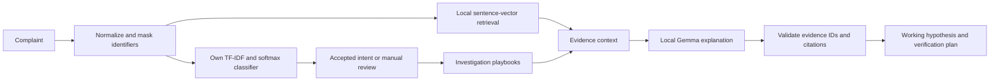

# Resolve: Customer Complaint Analyzer


Resolve analyzes English banking complaints. It identifies the reported problem, retrieves relevant context, proposes an **unverified root-cause hypothesis**, and gives the reviewer a concrete investigation plan. A local LLM adds an explanation with source evidence IDs and playbook citations.

## Clone and run on Windows

The repository includes the trained classifier, public dataset files, evaluation results, and local MiniLM sentence encoder. Install Python 3.13 and Git, then run:

```powershell
git clone https://github.com/vkg6835/resolve-complaint-analyzer.git
cd resolve-complaint-analyzer
py -3.13 -m venv .venv
& '.\.venv\Scripts\python.exe' -m pip install -r requirements-dev.txt
& '.\.venv\Scripts\python.exe' run_demo.py
```

The first launch creates a local SQLite database and adds the fictional demonstration complaints. The classifier and retrieval work locally. For new LLM explanations, install [Ollama](https://ollama.com), run `ollama pull gemma:2b`, and keep the Ollama service running.

## Run the prepared demo

Double-click **Start Demo.bat** in this folder. It opens **http://127.0.0.1:8000**. The project environment, dataset, trained models and local sentence encoder have been prepared on this laptop.

From PowerShell in this folder:

```powershell
& '.\.venv\Scripts\python.exe' run_demo.py
```

Keep the terminal running. Press Ctrl+C to stop. If port 8000 is occupied by another app, add `--port 8001`. The launcher recognizes an already running Resolve server.

Read [SHOW_TOMORROW.md](SHOW_TOMORROW.md) for a short presentation script and demo sequence. Read [Professor_Expectations.md](docs/Professor_Expectations.md) for the assignment analysis and likely evaluation priorities.

## What is working

- An overview dashboard and a persistent complaint inbox with search, category, priority and status filters.
- New complaint analysis using a TF-IDF vectorizer and multiclass logistic regression implemented from scratch.
- Word and character feature evidence, exact complaint quotations, and explicit uncertainty handling.
- Thirteen authored investigation playbooks, retrieved through accepted intent and lexical similarity.
- Local MiniLM sentence-vector retrieval of similar **training** queries, with a TF-IDF fallback.
- Root-cause hypotheses, a separate support-handoff hypothesis when reported, verification questions, suggested owners and preventive actions.
- Local Gemma explanations through Ollama, with constrained JSON, validated evidence IDs and validated playbook citations.
- Review status updates, report downloads, CSV export, and a draft reply for human review.
- A methodology page with actual experiment results, a confusion matrix, retrieval comparison and sentence-vector clusters.

The 24 starting inbox complaints and the playbooks are authored examples, clearly labeled in the app. They are separate from the real public benchmark. There are no bank integrations, and the app does not send a reply or take a financial action.

## Actual classifier results

All three feature configurations use identical splits and the same from-scratch softmax classifier, Adam optimizer and validation-based stopping rule.

| Features | Dimensions | Validation macro-F1 | Test macro-F1 |
|---|---:|---:|---:|
| Word unigrams | 616 | 88.34% | 91.43% |
| Word unigrams + bigrams | 2,924 | 89.44% | 91.41% |
| Words + bigrams + character 2/3/4-grams | 6,440 | 91.95% | **93.29%** |

The third configuration was selected using validation macro-F1. It correctly predicts 448 of 480 test queries, giving 93.33% accuracy. These scores measure **intent classification on a selected 12-category subset**, not a score on all 77 BANKING77 intents and not root-cause accuracy. The runtime also flags low-score, ambiguous and out-of-scope cases for review.

Full results are in [artifacts/evaluation.json](artifacts/evaluation.json), [experiment_summary.csv](artifacts/experiment_summary.csv), and [test_predictions.csv](artifacts/test_predictions.csv).

MiniLM retrieval reaches **97.08% intent hit@3**, versus **93.96% for TF-IDF**, on the same 480 held-out queries. The nearest-query intent accuracy is 92.08% versus 86.04%. These measure related-intent retrieval, not verified root-cause retrieval.

## Data and model provenance

- **BANKING77**, PolyAI, Casanueva et al. (2020), [dataset and license](https://huggingface.co/datasets/PolyAI/banking77), CC BY 4.0. Original: 13,083 customer service queries across 77 intents. This project selects 12 complaint-related intents.
- **Splits:** 1,443 training, 255 validation and 480 official test queries. The official test split is preserved. Validation uses a stratified 15% of the cleaned official training pool. Seed 127. One exact training duplicate was removed; there was no exact train/test overlap in the selected subset.
- **Sentence encoder:** [all-MiniLM-L6-v2](https://huggingface.co/sentence-transformers/all-MiniLM-L6-v2), Apache 2.0, pinned ONNX int8 file, 384 dimensions. Its pretrained WordPiece tokenizer and encoder run on the CPU. Attention-mask mean pooling and L2 normalization are implemented in this project.
- **Generative model:** existing local `gemma:2b` through Ollama. This model was not trained or fine-tuned by this project.

Dataset revision and checksums are saved in [data/provenance.json](data/provenance.json). Sentence-encoder revision, retrieval scores and clustering details are saved in [artifacts/retrieval_evaluation.json](artifacts/retrieval_evaluation.json).

## How the analysis works



Reported symptoms and root causes are different tasks. “Charged twice” is an observed complaint category. “Duplicate capture or an unreleased authorization” is a mechanism to investigate. The app asks whether both charges are settled, checks transaction references, and suggests reviewing retry handling or reconciliation after the trace. Repeated support contact can suggest a separate case-ownership issue, but ticket records are still needed.

## Local LLM behavior

Ollama must be running, with `gemma:2b` installed. Check with `ollama list`. The regular classifier, retrieval, evidence, reports and saved explanations work without a network connection. New LLM explanations require the local Ollama service, not an online API key.

The first generation can take a minute or longer while the model loads. The baseline result appears immediately. Subsequent requests are usually faster; generated explanations are stored with the case. A rejected or timed-out generation leaves the completed baseline available.

The model selects supplied evidence IDs. Code attaches the exact source quotations and rejects missing or unknown IDs. Citation IDs must belong to retrieved playbooks. These checks preserve attribution; they do **not** prove that an explanation is factually correct or causally valid.

To use another already installed Ollama model:

```powershell
$env:OLLAMA_MODEL = 'your-local-model-name'
& '.\.venv\Scripts\python.exe' run_demo.py
```

## Reproduce from the downloaded data

```powershell
& '.\.venv\Scripts\python.exe' scripts\prepare_data.py
& '.\.venv\Scripts\python.exe' scripts\train.py
& '.\.venv\Scripts\python.exe' scripts\build_retrieval.py
& '.\.venv\Scripts\python.exe' -m pytest -q
node tests\frontend_smoke.cjs
```

Training, evaluation and embedding construction run locally. Rebuilding a model does not automatically rewrite previously saved case analyses. The dataset test labels enter scoring after feature and checkpoint selection.

For a fresh environment, use Python 3.13:

```powershell
py -3.13 -m venv .venv
& '.\.venv\Scripts\python.exe' -m pip install -r requirements-dev.txt
```

To download the same public inputs again, install the current `hf` CLI separately and run:

```powershell
hf download PolyAI/banking77 --type dataset --revision 1846984189f2bc0ac51c6fc3a600fa9e1714e0c6 --local-dir data\banking77
hf download sentence-transformers/all-MiniLM-L6-v2 onnx/model_quint8_avx2.onnx tokenizer.json README.md 1_Pooling/config.json sentence_bert_config.json --revision 1110a243fdf4706b3f48f1d95db1a4f5529b4d41 --local-dir models\minilm
```

## Where to look in the code

| File | Responsibility |
|---|---|
| `app/ml.py` | Own TF-IDF, softmax regression, Adam, macro-F1 and spherical K-means |
| `scripts/prepare_data.py` | Public-data conversion, deduplication, stratified validation and provenance |
| `scripts/train.py` | Controlled experiments, validation-based selection and held-out scoring |
| `app/embeddings.py` | Offline sentence encoding, mask-aware mean pooling and normalization |
| `scripts/build_retrieval.py` | Training-only retrieval index, held-out retrieval scoring and clustering |
| `app/engine.py` | Classification, evidence, retrieval, masking and investigation hypotheses |
| `app/taxonomy.py` | The authored complaint taxonomy and demonstration playbooks |
| `app/llm.py` | Grounded prompt, constrained output and evidence validation |
| `app/main.py` | FastAPI endpoints, case workflow and export |
| `app/storage.py` | SQLite persistence and transactional updates |
| `static/` | Offline web interface with escaped user/model text |

## Current limits and next work

English banking complaints only. Short intent queries differ from longer complaint narratives, so some detailed cases need manual review. There are no verified root-cause labels or real bank transaction records. The playbooks are demonstration guidance rather than official policies. Priority and customer tone are explicit heuristics. Identifier masking handles common patterns and cannot guarantee removal of every sensitive detail.

Next: create a human-reviewed root-cause evaluation set, connect approved operational records, compare prompt-only and retrieval-grounded explanations, add Hindi/Hinglish complaints, and extend the taxonomy to airline or e-commerce complaints. Keep the public benchmark and the operational evaluation separate.
